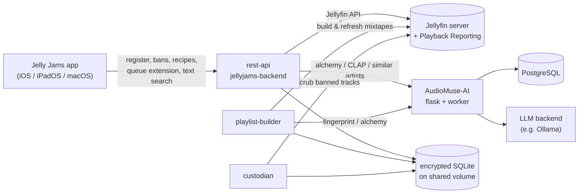

# Jelly Jams Backend

**The optional companion server for [Jelly Jams](https://github.com/PatrickTCB/JellyJams), my Jellyfin music client for iOS, iPadOS, and macOS.**

I try to make Jelly Jams a great Jellyfin music client all on its own. This backend / sidecar service is purely additive: run it next to your Jellyfin server and the app gains AI-built mixtapes, personal bans, an infinite queue, and a few other tricks.

If the features below sound like your kind of thing, this README will get you from zero to a running instance.

---

## What you get

### Mixtapes

Playlists generated by [AudioMuse-AI](https://github.com/NeptuneHub/AudioMuse-AI), and any playlist whose name ends in `_automatic`, show up in the app in their own **Mixtapes** library section. This section then gets quick-link tiles on the app's home screen. Tap one and playback starts immediately. The idea here is that because you didn't pick the songs on this playlist, it makes no sense to "View" it like you would for one that you hand crafted. Additionally, the app shows the name without the `_automatic` ending since that ending is meant to tell these services and the app how to treat the playlist — it's not really part of the name.

In the default Audio-Muse-AI configuration, all `_automatic` playlists are completely wiped and rebuilt on whatever schedule you configure in the "Scheduled Tasks" (cron) section of the web app.

### Custom mixtape recipes

Build your own AudioMuse-powered mixtapes from a recipe you define. They draw tracks from your recent listens, your favourites, and your AudioMuse sonic fingerprint, then top the list up with AudioMuse "alchemy" (tracks from the same neighbourhood of mood/genre space). Per recipe controls exist for the song count, the alchemy percentage, and whether alchemy tracks must be *fresh* (nothing you've played in the last year). Separately, per-account *Mixtape Limits* cap how many tracks from one album or one artist may land in any one generated tape (defaults: 3 per album, 5 per artist).

### Bans that are yours alone

On a Jellyfin server where multiple people add music, there are always songs, albums, or artists you never want to hear. Once your app install is connected to your backend, you can ban songs, albums, or artists straight from context menus or the now-playing screen (the same mechanism covers any Jellyfin item, genres included).

Your bans are only yours. If a massive N'Sync fan on your server bans the Backstreet Boys, it won't keep "Larger Than Life", "Backstreet's Back", or "I Want It That Way" out of *your* playlists and vice versa.

Bans are respected everywhere the backend picks music: mixtape builds, queue extension, alchemy results, and text search. The `custodian` container even scrubs already-banned tracks out of mixtapes that already exist. The app keeps a *Banned items* screen in its backend settings where you can review what you've banned and unban things one at a time or all at once.

### Infinite queue

The **Infinite Queue** offers the app a chance to keep the music going whenever the running queue runs short. For an unshuffled, in-order album listen it appends the next album the backend picks: the same artist's next release by premiere date, or an album from a similar artist once you've reached the end of their discography. Non-album listening sessions get alchemy seeded from the queue so far by adding what you've listen to, subtracting what you skipped.

### Text-to-tunes

Describe a vibe in plain language such as "high energy metal" or "rainy sunday morning", and the backend returns matching tracks from your library using AudioMuse's CLAP search filtered by your bans.

### A shared server playlist

Flip the join toggle in the app's backend settings, and you contribute to a communal playlist named `Family Blend` by default, but configurable in an environment variable. The list blends every signed-up user's recents, favourites, and fingerprints, plus a splash of alchemy to glue it together. It's then written into each member's library. Each user's bans still filter what *they* contribute, but the finished blend isn't scrubbed per user.

---

## How it fits together



Everything runs in six Docker containers, three of them built from this repo.

| Container | Built from | What it does |
|---|---|---|
| `jellyjams-backend` | `Dockerfile.rest-api` | The FastAPI REST API the Jelly Jams app talks to: registration, bans, mixtape recipes, queue extension, text-to-tunes. Exposed on `${REST_IP}:${REST_PORT}` (loopback by default). |
| `jellyjams-playlist-builder` | `Dockerfile.playlist-builder` | Every 2 minutes: rebuilds each user's custom mixtapes and the shared server playlist whenever one is missing or older than ~23 h. |
| `jellyjams-custodian` | `Dockerfile.custodian` | Creates and validates the encrypted SQLite schema at startup, then loops every 2 minutes removing banned tracks from your recently created or changed mixtapes (the shared server playlist is left alone). |
| `audiomuse-postgres` | `postgres:15-alpine` | AudioMuse-AI's database. |
| `audiomuse-ai-flask` | `ghcr.io/neptunehub/audiomuse-ai` | AudioMuse-AI web UI and API (analysis, clustering, alchemy, CLAP, similar artists). Exposed on `${AUDIOMUSE_PORT}`. |
| `audiomuse-ai-worker` | `ghcr.io/neptunehub/audiomuse-ai` | AudioMuse-AI queue worker that grinds through analysis and clustering jobs. |

The three containers from this repo share one database. It's an SQLCipher-encrypted SQLite database at `${SHARED_DATA}/jellyjams-server.db`, keyed with `DB_PW`, bind-mounted at `/data` in each of them. That's where users, bans, limits, recipes, and mixtape build history live.

---

## Prerequisites

- **Docker** (with Compose). Everything runs in containers; there is no supported non-Docker path.
- **A Jellyfin server** with a music library, reachable from the Docker host.
- **The [Jellyfin Playback Reporting plugin](https://github.com/jellyfin/jellyfin-plugin-playbackreporting).** Recent-listen data powers mixtape recipes, fresh-alchemy, and skip-aware queue extension. The backend queries playback history through the plugin's custom-query endpoint, which requires the registered Jellyfin user to have admin access. Without it (or without admin), those features degrade gracefully to favourites/fingerprint/alchemy only.
- **An LLM backend for AudioMuse-AI.** [Ollama](https://ollama.com/) is the default and what I recommend; see the [AudioMuse-AI docs](https://github.com/NeptuneHub/AudioMuse-AI) for other providers.
- **The [Jelly Jams app](https://github.com/PatrickTCB/JellyJams)** on at least one device, to actually use all of this.
- **Patience for the first analysis.** AudioMuse has to scan to your whole library before anything smart can happen. I can't say how long that will take for you, but in my testing a library with ~1000 albums (240 GB) took about a day on an M1 Max with `qwen3.8:27b`. Your mileage will vary with library size, hardware, and model.

---

## Setup

1. **Clone this repository** and `cd` into it.

2. **Create your environment file** and fill in every variable (see [Environment variables](#environment-variables) below):

   ```sh
   cp env.example .env
   $EDITOR .env
   ```

   You'll need a couple of secure passwords. On macOS this command generates one and puts it straight on your clipboard:

   ```sh
   openssl rand -base64 48 | tr -dc 'A-Za-z0-9' | pbcopy
   ```

   (`pbcopy` is macOS only, so on Linux you can use something like `xclip` and then replace `pbcopy` with `xclip -selection clipboard`. On Windows, replace `pbcopy` with `scb`)

3. **Create the host directories** you referenced in `.env` (`SHARED_DATA`, `AUDIOMUSE_POSTGRES_DATA`, `AUDIOMUSE_AUDIO_FOLDER`, `AUDIOMUSE_PLUGINS`) if they don't exist yet. Docker will create missing bind-mount sources for you, but doing it yourself keeps ownership and permissions predictable. Keeping the AudioMuse temp-audio folder outside the container lifecycle is a must if you want good performance.

4. **Bring up the stack:**

   ```sh
   docker compose up --build -d
   ```

   This builds the three images from this repo and pulls PostgreSQL and AudioMuse-AI. You now have six containers.

5. **Set up AudioMuse-AI.** Open its web UI at `http://<your-host>:${AUDIOMUSE_PORT}` (port 8000 with the default variables) and:
   1. create your AudioMuse user account,
   2. connect it to your Jellyfin server,
   3. connect it to your Ollama instance (or whichever LLM provider you chose),
   4. run **Analysis**, then **Clustering**.

   These two jobs are the long part. You should keep going through these steps, just keep in mind that these jobs won't be done for a long while.

6. **Hand the backend its AudioMuse login.** Once the account from step 5 exists, set either `AUDIOMUSE_USER` and `AUDIOMUSE_PW` or `AUDIOMUSE_API_KEY` in `.env` to the credentials you set and re-apply:

   ```sh
   docker compose up --build -d
   ```

   The `playlist-builder` and `rest-api` containers use this login to call the AudioMuse API. Until it's set, they'll log auth errors.

7. **Install the Playback Reporting plugin** on your Jellyfin server (Dashboard → Plugins → Catalog), if you haven't already, and make sure the Jellyfin users who will register with the backend have admin access (see Prerequisites).

8. **Connect the Jelly Jams app.** In the app, open Settings → *Jelly Jams Backend*, enter `http://<your-host>:${REST_PORT}` as the server address, and press **Save**. If the app runs on a different device than the Docker host (the usual case), set `REST_IP` in `.env` to the server's LAN or Tailscale IP — or `0.0.0.0` — and `docker compose up --build -d` before connecting, since the default binds loopback only (see [Networking](#networking)). Saving registers your Jellyfin account with the backend (the backend validates the credentials against your server), and the registration answer tells the app the mixtape suffix and server-playlist name, which unlocks the Mixtapes section, bans, Infinite Queue extensions, and the rest of the backend settings.

9. **Enjoy.** Registering validates your Jellyfin credentials against your server and stores them in the encrypted database. From there: create mixtape recipes in the app, ban Baby Shark or whatever you don't want to hear, opt into the server playlist, and let the builders do their rounds (they check every 2 minutes). How good your mixtapes or other generated playlists are will depend some on how many songs you've favourited, and how much listening you do. With a healthy number of favourites, it should only take one or two days of listening before you can generate all kinds of cool mixtapes for yourself.

---

## Networking

- **REST API bind.** `docker-compose.yml` publishes the API as `${REST_IP}:${REST_PORT}:8000`. With the default `REST_IP=127.0.0.1` it is reachable only from the Docker host itself — a sane default for a reverse-proxy setup, but phones and other devices can't reach it. If your clients connect directly, set `REST_IP` in `.env` to the server's LAN IP (e.g. `192.168.0.2`) or Tailscale IP, or to `0.0.0.0` for every interface, then `docker compose up -d` to republish the port. Alternatively leave it on loopback and front it with a reverse proxy of your choice. Personally, I use nginx.
- **AudioMuse UI** is published on all interfaces (`${AUDIOMUSE_PORT}:8000`). It has its own login, but keep it off the public internet.
- **The REST API itself has no authentication** — it trusts the `userID` its clients present, which is fine for a home network where the backend is a personal sidecar. Treat it accordingly: keep `REST_IP` on a private interface or behind an authenticated proxy, never bare on the internet.

---

## Environment variables

All variables live in `.env` (see `env.example`). Grouped by what consumes them:

### Core (rest-api, playlist-builder, custodian)

| Name | Example | Explanation |
|---|---|---|
| `DB_PW` | `double-secret-password` | SQLCipher key for the shared SQLite database. Change it. If you lose it, the database is unrecoverable by design. |
| `REST_PORT` | `8080` | Host port the REST API is published on. |
| `REST_IP` | `127.0.0.1` | Host interface the REST API port is published on. The default binds loopback only, so only the Docker host can reach the API; set it to the server's LAN/Tailscale IP (or `0.0.0.0`) if clients connect directly. See [Networking](#networking). |
| `SHARED_DATA` | `/data/shared` | Host directory bind-mounted to `/data` in the three app containers; holds `jellyjams-server.db`. |
| `PLAYLIST_SUFFIX` | `"_automatic"` | Suffix that marks managed mixtapes. The backend tells the app this suffix in its `/register` answer, so the app's Mixtapes section follows whatever you set here. The default `_automatic` is also what AudioMuse-AI gives its own generated lists — which is why those show up as Mixtapes too. Currently, you can't configure this in AudioMuse-AI. But just in case you can someday, I already set it up to be configurable here. |
| `SERVER_PLAYLIST` | `"Family Blend"` | Display name of the opt-in shared playlist; it is built as `<SERVER_PLAYLIST>_automatic`. |

### AudioMuse-AI

| Name | Example | Explanation |
|---|---|---|
| `AUDIOMUSE_HOST` | `"http://audiomuse"` | URL the backend containers use to reach the AudioMuse API. The default works because the compose file names the flask container `audiomuse`; only change it if you run AudioMuse outside this compose stack or if you put Audio-Muse-AI behind a reverse proxy and want that to be the primary way in. |
| `AUDIOMUSE_USER` | `admin` | The AudioMuse login (created in step 5 of Setup) that `playlist-builder` & co. use for API calls. |
| `AUDIOMUSE_PW` | `probably-shouldnt-be-admin` | Password for that user. Pick a real one. |
| `AUDIOMUSE_API_KEY` | `really-shouldnt-be-admin` | This API key can be used instead of a username and password. If it's set then the username and pw variables won't be used. |
| `AUDIOMUSE_PORT` | `8000` | Host port the AudioMuse web UI is published on. |
| `AUDIOMUSE_TZ` | `"Europe/Berlin"` | Timezone for all the AudioMuse containers (Postgres, web UI, and worker), including AudioMuse's scheduled tasks. |
| `AUDIOMUSE_POSTGRES_USER` | `audiomuse` | Postgres user for AudioMuse's database. No need to change it. |
| `AUDIOMUSE_POSTGRES_PASSWORD` | `triple-secret-password` | I know a triple-secret password sounds very secure, but change this one too. |
| `AUDIOMUSE_POSTGRES_PORT` | `5432` | Host port for AudioMuse's Postgres. This instance is for AudioMuse alone. |
| `AUDIOMUSE_POSTGRES_DATA` | `"/data/db"` | Host folder where Postgres stores AudioMuse's data. |
| `AUDIOMUSE_AUDIO_FOLDER` | `"/data/temp-audio"` | Host folder for the temp audio files AudioMuse creates while analyzing tracks. Keeping it outside the container lifecycle makes subsequent analysis runs faster. |
| `AUDIOMUSE_PLUGINS` | `"/data/plugins"` | Host folder where AudioMuse keeps installed plugins. |

---

## REST API

The API is what the Jelly Jams app calls; you normally never touch it by hand. It's a FastAPI app, so once it's running you get interactive OpenAPI docs at `http://${REST_IP}:${REST_PORT}/docs` and Redocly documentation at `http://${REST_IP}:${REST_PORT}/redoc`.

| Method | Path | Purpose |
|---|---|---|
| `GET` | `/ping` | Liveness check (`pong` + server time). |
| `POST` | `/register` | Register a Jellyfin user with the backend; credentials are validated against Jellyfin before being stored. Re-registering updates the stored credentials. |
| `DELETE` | `/delete-me` | Remove a user and everything belonging to them (bans, limits, recipes, signups). |
| `GET` | `/tapes` | List a user's mixtape recipes. |
| `POST` | `/new-tape` | Create or update a mixtape recipe (sources, alchemy %, fresh-alchemy flag, song count). |
| `DELETE` | `/delete-tape` | Delete a mixtape recipe. |
| `GET` | `/extend-queue` | Return up to 5 more track IDs via alchemy over the given queue, subtracting tracks the user skipped. |
| `GET` | `/extend-queue-by-album` | Return the track IDs of the "next album" (same artist's next release by premiere date, else a similar artist's album), falling back to alchemy. |
| `GET` | `/text-to-tunes` | CLAP search: natural-language query in, matching track IDs out. |
| `POST` / `DELETE` | `/ban` | Ban / unban a Jellyfin item (song, album, or artist) for one user. |
| `GET` | `/bans` | List everything a user has banned, grouped by item type. |
| `DELETE` | `/reset-bans` | Clear all of a user's bans. |
| `GET` / `POST` | `/limits` | Read / set a user's per-playlist limits (max songs per album, max songs per artist; defaults 3 and 5). |
| `GET` / `POST` / `DELETE` | `/server-playlist` | Read / opt in to / opt out of the shared server playlist. |

See `/redoc` or `/docs` for more details and response models.

---

## Repository layout

| Path | Contents |
|---|---|
| `rest-api/` | The FastAPI service (`main.py`). |
| `playlist-builder/` | `loop.sh` scheduler, `main.py` (per-user mixtape recipes), `server-playlist.py` (the shared playlist). |
| `custodian/` | Startup schema creation plus the banned-track scrub loop. |
| `lib/` | Shared clients: `jellyfin.py`, `audiomuse.py`, `discogs.py`, `musicbrainz.py`, `db.py` (SQLCipher helpers), `common.py`. |
| `Dockerfile.*` | One image per service from this repo. |
| `docker-compose.yml` | The six-container stack. |

---

## Troubleshooting

- **`playlist-builder` / `rest-api` logs show AudioMuse auth errors.** `AUDIOMUSE_USER` / `AUDIOMUSE_PW` and/or `AUDIOMUSE_API_KEY` don't match the account you created in the AudioMuse web UI (setup step 5 → 6). Fix `.env`, then `docker compose up -d`.
- **"Couldn't get playback info for …" or mixtapes with no recent-listen tracks.** The Playback Reporting plugin is missing, or the registered Jellyfin user lacks admin access (the playback-history endpoint requires it).
- **The app can't reach the backend.** The REST port is published on `${REST_IP}`, which defaults to `127.0.0.1` — loopback only. Set `REST_IP` to the server's LAN/Tailscale IP (or `0.0.0.0`) and `docker compose up -d` to republish. See [Networking](#networking).
- **My mixtape disappeared and came back a minute later.** Expected: AudioMuse-AI deletes all `_automatic` playlists when it rebuilds its own, and the playlist-builder restores yours within ~2 minutes.
- **Nothing seems smart yet.** Analysis and clustering have to finish first (setup step 5). Check progress in the AudioMuse UI; check the backend's own behaviour with `docker compose logs -f jellyjams-playlist-builder`.
- **Everything was fine and then a container restarted.** All services use `restart: unless-stopped`; a crash loop usually shows its reason in `docker compose logs <container>`.

---

## Credits

- [AudioMuse-AI](https://github.com/NeptuneHub/AudioMuse-AI) by NeptuneHub does all of the heavy musical lifting — analysis, clustering, fingerprints, alchemy, CLAP. This backend is essentially an opinionated orchestra for it.
- [Jellyfin](https://jellyfin.org/) and the [Playback Reporting plugin](https://github.com/jellyfin/jellyfin-plugin-playbackreporting).
